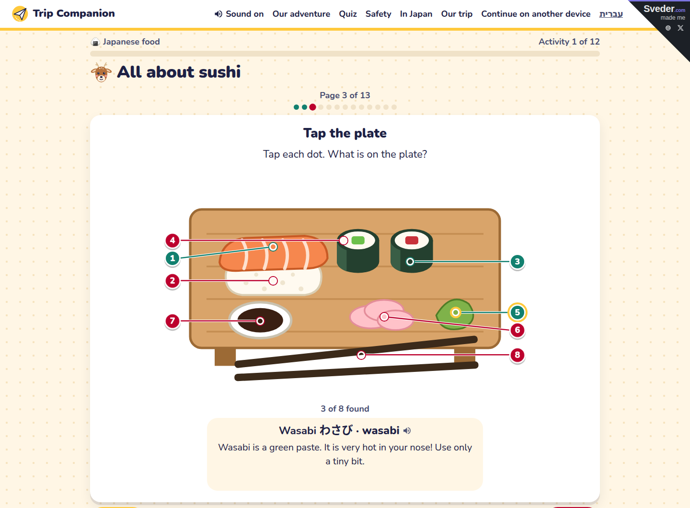

# Trip Companion

A web app that gets a family ready and excited for a trip abroad: short activities for kids and grown-ups,
picked for the family, one at a time. Japan is complete. Uzbekistan is a work in progress. Works on a phone, a laptop
and a TV browser, in English and in Hebrew.

Live: https://trip.sveder.com

## For judges

Try these in about 5 minutes on https://trip.sveder.com. You do not sign in: a new visitor is a guest family.

1. On the home page, tap "Let's go!", then "Let's start".
2. On "Plan your adventure", keep Japan, set the kids and grown-ups with the + and − buttons, and tap
   "Start our adventure!". The app picks the activities for this family and opens the first one, "All about sushi".
3. Swipe (or tap "Next") through the pages. On page 3, "Tap the plate", tap each dot on the sushi plate.
4. Tap "Our adventure" in the header to see every activity. Open a "Hunt" and find the things on a real Japanese
   street in Street View.
5. After you finish one activity, tap "Quiz". The quiz asks about the activities you did.
6. Tap "Safety" for the emergency numbers (police 110, fire and ambulance 119) and "Print a child safety card".
7. Tap "In Japan" for the photo hunt that a family does during the trip.
8. Add `?lang=he` to any page for Hebrew (right to left), or `?tv=1` for the TV mode: big cards for a remote control.
   The header link switches the language back.

## How it was built

- The plan came first, with the Devpost plan-first skill pack:
  [scope](devpost/scope.md), [PRD](devpost/prd.md), [spec](devpost/spec.md) and [checklist](devpost/checklist.md).
- The checklist splits the build into slices. Each slice has a build line, a verify line and a commit.
- A factory of agent runs built the slices one at a time, from the checklist, and wrote each change to the plan
  under "Revisions".
- Django on the server. Plain CSS and plain JavaScript in the browser, with no build step.
- The photos are free-licence photos from Wikimedia Commons; `/credits/` lists each one with its author and licence.
  Some pictures are SVG files. The content of each module is one YAML file in `content/japan/` or
  `content/uzbekistan/`.

## Run it locally

    python3 -m venv venv
    venv/bin/pip install -r requirements.txt
    venv/bin/python manage.py migrate
    venv/bin/python manage.py load_content japan uzbekistan
    venv/bin/python manage.py runserver

Open http://127.0.0.1:8000/. No keys are needed. Emails (sign-in codes, reminders) print in the terminal (console
email backend).

## Tests

    venv/bin/python manage.py test

## Content

Each module is one YAML file in `content/<country>/`. `manage.py load_content japan uzbekistan` loads them into the
database.

A superuser edits the content at `/admin/` (`manage.py make_superuser <email>`; staff sign in at `/signin/` with a
one-time email code, no password). A module changed in the admin is marked `edited`, and `load_content` leaves it alone until
`manage.py export_content japan` writes it back to its YAML file. The export changes only the values that differ and
keeps the comments in the files.

## Deploy

`deploy/` holds the nginx site, the gunicorn systemd unit and `deploy.sh`. Secrets live in `.env` on the server only;
`.env.example` lists the names.

Made by [Sveder](https://sveder.com). MIT licence.
